# Hand State Machine

**Project:** Poker Game  
**Version:** 1.0  
**Scope:** Phase 1 No-Limit Texas Hold'em hand lifecycle, betting, timeouts, showdown, and settlement  
**Related documents:** `Room_State_Machine_v1.0.md`, `Session_State_Machine_v1.0.md`

## 1. Overview

A Hand is one complete deal of No-Limit Texas Hold'em within an ACTIVE Session. The backend Game Engine is authoritative for dealing, turn order, legal actions, timers, pots, and payouts. Hand state transitions are serialized per table to avoid conflicting player actions.

Phase 1 uses Small Blind = 1 and Big Blind = 2. **Straddle is not supported in Phase 1.** Phase 2 may introduce Straddle and Re-straddle; their detailed rules are intentionally deferred. The engine should model the current forced bet and minimum legal raise dynamically rather than assume all preflop betting always begins at 2.

## 2. Hand States

| State | Meaning |
|---|---|
| `SETUP` | Select eligible players and positions, prepare deck, post blinds, deal private cards. |
| `PREFLOP` | First betting round. |
| `FLOP` | Deal three community cards and run betting round. |
| `TURN` | Deal fourth community card and run betting round. |
| `RIVER` | Deal fifth community card and run betting round. |
| `RUNOUT` | No further betting is possible; automatically deal remaining community cards. |
| `SHOWDOWN` | Reveal eligible hands, rank hands, and determine pot winners. |
| `SETTLEMENT` | Return uncalled chips, allocate pots, persist results, and apply deferred hand-end operations. |
| `COMPLETED` | Hand is fully settled; terminal state. |

`RUNOUT` is entered only when at least two non-folded players remain and no further betting is possible. A Hand may reach `SETTLEMENT` directly when all but one player fold.

## 3. State Diagram

```mermaid
stateDiagram-v2
    [*] --> SETUP: Start eligible Hand
    SETUP --> PREFLOP: Post blinds and deal hole cards

    PREFLOP --> FLOP: Betting complete; betting still possible
    FLOP --> TURN: Betting complete; betting still possible
    TURN --> RIVER: Betting complete; betting still possible
    RIVER --> SHOWDOWN: Betting complete

    PREFLOP --> RUNOUT: No further betting possible
    FLOP --> RUNOUT: No further betting possible
    TURN --> RUNOUT: No further betting possible
    RUNOUT --> SHOWDOWN: Deal remaining board

    PREFLOP --> SETTLEMENT: One non-folded player remains
    FLOP --> SETTLEMENT: One non-folded player remains
    TURN --> SETTLEMENT: One non-folded player remains
    RIVER --> SETTLEMENT: One non-folded player remains

    SHOWDOWN --> SETTLEMENT: Evaluate eligible hands and pots
    SETTLEMENT --> COMPLETED: Persist final results
    COMPLETED --> [*]
```

A betting round may also proceed directly to the next street without requiring actions when all eligible players are all-in; the implementation should use `RUNOUT` for that case. The transition to `RUNOUT` occurs only after all outstanding calls/folds have been resolved and no actionable betting remains.

## 4. Hand Creation and Setup

### HT-01: Start a Hand

Preconditions:
- Session is `ACTIVE` and has not reached its deadline.
- No other Hand is active in the Session.
- At least two eligible players are seated.
- Deferred actions from the previous Hand (including Top-ups and seat changes) are resolved.

Actions:
1. Assign the next `hand_no`.
2. Determine Button, Small Blind, and Big Blind positions, including heads-up rules.
3. Determine eligible participants and their starting stacks.
4. Initialize per-Hand consecutive-timeout counters to zero.
5. Shuffle/deal server-side; store information needed for audit/recovery securely.
6. Post mandatory blinds, allowing a partial all-in blind when a player cannot cover the required amount.
7. Deal two private cards per player.
8. Enter `PREFLOP` and select the first player to act.

### HT-02: First-Hand Mandatory Big Blind

A player newly seated in the Session must post the mandatory Big Blind (2 chips) on their first eligible Hand. A partial all-in blind is permitted if their stack is below 2. The Hand engine must avoid collecting the same mandatory BB twice if the player is also assigned the ordinary BB position. Exact seat-entry scheduling and button movement must be consistent across Hands.

## 5. Betting Rounds

### 5.1 Action order

- Preflop with three or more players: the first player to act is the first eligible player clockwise from the Big Blind.
- Heads-up preflop: the Button/Small Blind acts first.
- Flop, Turn, River: the first eligible player clockwise from the Button acts first; heads-up, the Big Blind acts first.
- Folded or all-in players are skipped when selecting an actor.
- Only the backend-designated actor may submit a turn action.

### 5.2 Legal actions

- `FOLD`: surrender eligibility to win contested pots.
- `CHECK`: only when no additional chips are required to continue.
- `CALL`: contribute the lesser of the amount owed and remaining stack; a short call is all-in.
- `BET`: open betting when no live wager exists, subject to minimum bet and available stack.
- `RAISE`: increase the live wager, subject to minimum full-raise rules and remaining stack.
- `ALL_IN`: commit all remaining chips; legality and whether this reopens raising depend on current betting history.

Every action is checked against current Hand state, player eligibility, turn ownership, stack, bet-to amount, and legal raise rights. Invalid or stale actions are rejected without changing state.

### 5.3 Minimum raises and short all-ins

- A full raise must increase the current wager by at least the size of the preceding full bet/raise increment, unless the player is all-in for less.
- A short all-in may increase the amount others must call without reopening raising to players who already acted and have not faced a full raise.
- A player may not wager more chips than they possess.
- Track the live amount to call, the minimum full-raise increment, each player's contribution, and whether their raise right is open.
- Do not hardcode the opening wager to the Big Blind; Phase 2 may add Straddle/Re-straddle.

### 5.4 Betting round completion

A round ends when every non-folded player who can still act has received the required opportunity to act and has either matched the current wager or is all-in, and no unresolved action remains. A raise may require previously acting players to respond again.

If exactly one non-folded player remains, go to `SETTLEMENT` without showdown. If at least two remain and no further betting can occur, go to `RUNOUT` (or `SHOWDOWN` if the full board is already dealt). Otherwise proceed to the next street.

## 6. Turn Timer and Timeouts

### HT-03: Turn timeout

- Each action turn has a 30-second deadline, enforced server-side.
- When the deadline expires, the engine automatically `CHECK`s if checking is legal; otherwise it automatically `FOLD`s.
- A timeout increments the player's consecutive-timeout counter for the **current Hand only**.
- A valid, timely player action resets that counter to zero.
- Counters reset to zero at the start of each new Hand.
- On the second consecutive timeout within one Hand, mark the player for automatic stand-up **after that Hand ends**. Do not remove a participant mid-Hand.
- Automatic actions are recorded in the action history with their timeout origin.

### HT-04: Disconnect

- Disconnect does not pause the 30-second action clock.
- The 60-second reconnection grace period is a separate connection/participation rule.
- Reconnecting restores the player's authoritative current Hand view and remaining action time, if any.
- If disconnect grace expires, process the resulting leave/stand behavior without corrupting the Hand; a player with a pending turn must still receive the applicable timeout action.

## 7. All-in and Automatic Runout

### HT-05: Enter RUNOUT

Enter `RUNOUT` only after required responses are resolved and no further wagering between eligible players is possible. Examples include all non-folded players being all-in, or only one non-folded player retaining chips while all others are all-in and that player has no unresolved call.

Actions:
1. Close betting and determine any uncalled contribution to return.
2. Deal any remaining community cards automatically in street order.
3. Record dealt cards and relevant transitions.
4. Enter `SHOWDOWN`.

All-in players remain eligible for only the pots supported by their contributions.

## 8. Showdown and Pot Settlement

### HT-06: Showdown

- All players reaching Showdown automatically reveal their hole cards; Phase 1 does not offer a manual Muck choice.
- Evaluate each eligible player's best five-card poker hand using their two hole cards and the community cards (any valid five-card combination).
- Construct the main pot and side pots according to contribution levels and eligibility.
- For each pot, determine eligible winners and distribute chips; tied winners split that pot.
- Use a deterministic rule for odd chips, documented and tested before implementation.

### HT-07: Settlement

1. Finalize player contributions and return any uncalled amount.
2. Build and award the main pot and side pots, or award the uncontested pot to the sole remaining player.
3. Compute and persist each `HAND_PLAYER.ending_stack` and Hand result.
4. Persist Hand completion and action/card history consistently; ensure settlement is idempotent.
5. Resolve pending stand/leave/kick requests after the Hand, preserving player and Hand history.
6. Process pending Top-ups using the **post-Hand stack**, before the next Hand or final Session settlement. A request exceeding the available cap is cancelled entirely, never partially filled.
7. If Session time has expired, finish the Session settlement; otherwise, if at least two eligible seated players remain, automatically start the next Hand.

**Top-up between Hands:** When no Hand is in progress, validate and apply a valid Top-up immediately before the next Hand begins.

**Top-up at Session expiry:** Requests accepted before expiry remain pending through the final Hand; after that Hand settles, process valid requests before final Session settlement, even though no next Hand will occur.

## 9. Automatic Next Hand

A completed Hand triggers the next Hand automatically only if:
- The Session is still `ACTIVE` and its deadline has not been reached.
- At least two eligible players are seated.
- Previous Hand settlement, Top-ups, and deferred seat changes are complete.
- No other Hand is active.

If fewer than two eligible players remain, the Session stays `ACTIVE` and its timer continues. A later arrival may allow gameplay to resume before the deadline. The Host does not need to start each Hand manually.

## 10. Phase 1 Straddle Policy and Phase 2 Extension

**Phase 1:** No Straddle or Re-straddle actions, options, or forced-bet placements are allowed. Only normal SB/BB and the agreed first-entry mandatory BB apply.

**Phase 2:** Support Straddle **and Re-straddle**. Design the betting engine so forced bets, the effective preflop opening amount, action order, and minimum raise calculations are configurable. Do not commit yet to a Straddle amount, allowed positions, number of Re-straddles, eligibility, or short-stack handling; these require a separate Phase 2 rule decision.

## 11. Backend and Persistence Requirements

- Serialize commands per active Hand/table; reject duplicate, late, and out-of-turn commands.
- Persist `HAND`, `HAND_PLAYER`, `ACTION`, and `CARDS` consistently with the approved schema.
- The Game Engine may calculate transient action order and legal actions in memory, but recovery must reconstruct or safely resume authoritative state.
- Never reveal other players' private cards before Showdown, except where an explicitly authorized rule permits it.
- Hand settlement, chip distribution, and application of Top-ups must be protected from duplicate execution after retries or restart.
- The UI displays authoritative state and does not independently determine valid actions or payouts.

## 12. Invariants

1. At most one Hand is active in a Session.
2. A Hand starts only before the Session deadline and with at least two eligible seated players.
3. Only the designated player can take a voluntary turn action.
4. A player's committed chips cannot exceed their available stack.
5. Folded players cannot win contested pots; all-in players cannot act further.
6. Total chips are conserved across a Hand except for explicitly recorded Buy-in/Top-up transactions outside Hand betting.
7. No Hand is `COMPLETED` until all pots are awarded and results are persisted.
8. Timeouts are counted only within the current Hand and reset after a timely valid action.
9. A second consecutive timeout triggers stand-up after the Hand, not during it.
10. No Straddle/Re-straddle is allowed in Phase 1.
11. No new Hand begins after Session expiry.
12. Final-Hand pending Top-ups are resolved before Session completion.

## 13. Open Implementation Details (not additional Phase 1 feature commitments)

The following should be specified in rule tests before coding: exact button movement when seats become empty, how the first-entry mandatory BB interacts with a player who joins mid-rotation, deterministic odd-chip allocation, short all-in reopening examples, and the precise recovery behavior for an interrupted settlement. These are implementation details to make the confirmed game rules unambiguous, not a request to expand Phase 1 scope.
