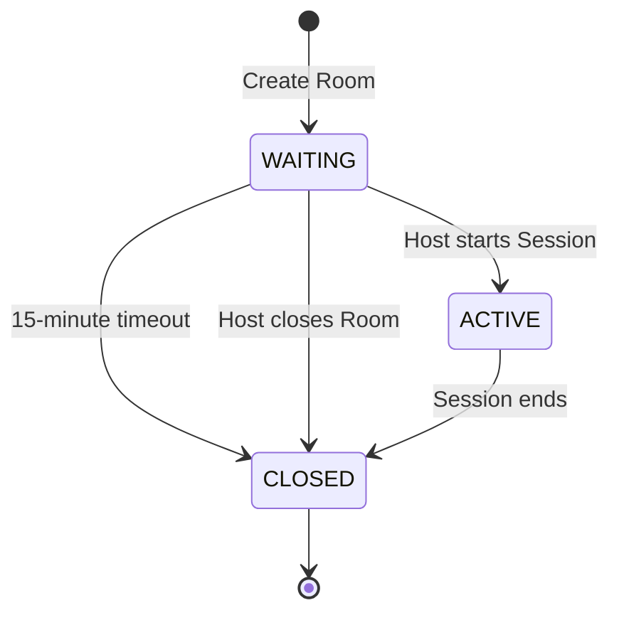

# 1. Room State Machine

**Project:** Poker Game  
**Version:** 1.0  
**Status:** Approved  
**Scope:** Room lifecycle, membership, host permissions, and room-level operations.

## 1.1 Overview

The Room State Machine manages the lifecycle of a poker room from creation to closure.

Each Room can have one Session. The Room manages membership and permissions, while the Session and Hand State Machines manage gameplay and settlement.

All state transitions and permission checks are controlled by the backend.

## 1.2 Room States

| State | Description |
|---|---|
| `WAITING` | Room has been created and is waiting for the host to start a Session. |
| `ACTIVE` | A Session has started and the room supports active gameplay. |
| `CLOSED` | Room is permanently closed. No further participation is allowed. |

### State Transition Diagram

## 1.3 State Transitions

### RT-01: Create Room

**From:** Initial  
**To:** `WAITING`

Conditions:
- The requesting user is authenticated.
- A unique six-digit room code is generated.
- The creator becomes the initial Room Host.
- The room creation time is recorded.
- The 15-minute waiting timer begins.

### RT-02: Start Session

**From:** `WAITING`  
**To:** `ACTIVE`

Conditions:
- Only the current Room Host may start the Session.
- At least two players must be seated.
- The Room has not expired.
- The host selects a Session duration of 30, 60, 90, or 120 minutes.

Actions:
- Start the associated Session.
- Change Room status to `ACTIVE`.
- Notify connected Room members.

### RT-03: Waiting Timeout

**From:** `WAITING`  
**To:** `CLOSED`

Trigger:
- The Room has not started a Session within 15 minutes of creation.

Actions:
- Reject further room operations.
- Cancel any unstarted Session, if one exists.
- Notify connected members.
- Preserve required historical records.

### RT-04: Host Closes Room

**From:** `WAITING`  
**To:** `CLOSED`

Conditions:
- Only the current Room Host may request closure.
- The Room must be in `WAITING`.

Actions:
- Close the Room.
- Cancel any unstarted Session, if applicable.
- Notify connected members.

The host cannot manually close an `ACTIVE` Room.

### RT-05: Session Ends

**From:** `ACTIVE`  
**To:** `CLOSED`

Trigger:
- The associated Session reaches its completion condition.

Actions:
- Allow any Hand already in progress to finish.
- Complete the Hand settlement.
- Process applicable pending operations.
- Finalize Session balances and results.
- Mark the Session as completed.
- Change Room status to `CLOSED`.
- Notify connected members.

## 1.4 Allowed Operations

| Operation | WAITING | ACTIVE | CLOSED |
|---|:---:|:---:|:---:|
| Join Room | Yes | Yes | No |
| Leave Room | Yes | Yes | No |
| Sit Down | Yes | Yes | No |
| Stand Up | Yes | Yes | No |
| Initial Buy-in | Yes | Yes | No |
| Top-up Request | No | Yes | No |
| Kick Player (Host) | Yes | Yes | No |
| Start Session (Host) | Yes | No | No |
| Close Room (Host) | Yes | No | No |
| Poker Action | No | Yes | No |

All operations remain subject to authentication, membership, seating, Session, and Hand rules.

## 1.5 Room Membership

### RM-01: Join Room

- Users may join a Room in `WAITING` or `ACTIVE`.
- Total Room membership is limited to 20 users, including spectators.
- Users may join as spectators without taking a seat.
- A user previously kicked from the Room cannot rejoin that same Room.
- Room access requirements, including any configured password, must be validated by the backend.

### RM-02: Seating

- A maximum of nine players may be seated.
- Players may take available seats in `WAITING` or `ACTIVE`.
- A player who sits down during an ongoing Hand cannot participate in that Hand.
- The existing first-entry big-blind rule applies when the player becomes eligible for the next Hand.
- Standing up during a Hand follows the Hand State Machine's deferred-exit rules.

### RM-03: Rejoining

- A user who voluntarily leaves may rejoin an open Room, subject to capacity and access rules.
- Rejoining the same Session does not create a second initial Buy-in.
- Existing Session participation records and remaining Stack are preserved.
- A kicked user is not eligible to rejoin the same Room.

## 1.6 Host Management

### RH-01: Host Transfer

If the current host voluntarily leaves the Room, host ownership is automatically transferred to another eligible Room member.

The new host inherits all Room Host permissions, including starting the Session in `WAITING` and kicking players.

**Host selection policy:**
- Select the eligible Room member with the earliest `first_join_at`.
- Exclude the departing host and kicked members.
- If multiple members have the same join time, use `user_id` as a deterministic tie-breaker.

If no eligible member remains:
- In `WAITING`, close the Room.
- In `ACTIVE`, preserve the running Session; final behavior when the Room becomes empty is governed by the Session State Machine.

Temporary disconnections are handled under the existing reconnection grace rules and do not automatically constitute a voluntary departure.

### RH-02: Kick Player

- Only the current host may kick another Room member.
- Kicking is allowed in `WAITING` and `ACTIVE`.
- The host cannot kick themselves; they must leave voluntarily.
- A kicked user is prohibited from rejoining the same Room.
- If the target is participating in an active Hand, removal must respect the Hand State Machine's fold and settlement rules.
- Kicking must not delete historical actions, transactions, or Session participation records.
- Pending Top-up requests belonging to a removed player must be resolved or cancelled according to the applicable Session rules.

## 1.7 Buy-in and Top-up

### RB-01: Initial Buy-in

- Phase 1 minimum Buy-in: 100 chips.
- Phase 1 maximum Buy-in: 400 chips.
- The maximum is obtained through the Room configuration interface, `getMaxBuyIn()`, rather than being hardcoded throughout the application.
- Initial Buy-in creates or initializes the player's Session participation according to the Session rules.
- Returning players retain their existing Session balance.

### RB-02: Top-up Request

- Top-up is available during an `ACTIVE` Session to seated players.
- Players may request Top-up during an ongoing Hand.
- A Top-up request does not immediately change the player's available Stack.
- Each player may have at most one pending Top-up request.
- Pending requests are evaluated after the current Hand is settled and before the next Hand begins.

The available Top-up amount is:

`max(0, getMaxBuyIn() - finalStack)`

If the requested amount exceeds the available amount:
- Cancel the entire request.
- Do not automatically reduce the requested amount.
- Notify the player to enter a new amount.

If the amount is valid:
- Apply the entire requested Top-up.
- Update the player's Session Stack.
- Record the successful `TOPUP` transaction.

Winning chips may cause a player's Stack to exceed the Buy-in maximum. The maximum restricts chips added through Buy-in and Top-up, not winnings.

The frontend should prevent obviously invalid requests, but the backend must perform the authoritative validation.

## 1.8 Backend Enforcement

The backend is authoritative for Room state, membership, host permissions, and operation eligibility.

The backend must:

- Reject operations incompatible with the current Room state.
- Authenticate users before processing requests.
- Verify host permissions for restricted operations.
- Enforce membership and seating limits.
- Prevent kicked users from rejoining.
- Ensure state transitions are atomic.
- Prevent duplicate execution of concurrent requests.
- Coordinate Room closure with Session and Hand settlement.

Frontend controls provide user feedback but do not replace backend validation.

## 1.9 Invariants

The following conditions must always hold:

1. A Room has exactly one current state.
2. A `CLOSED` Room cannot return to `WAITING` or `ACTIVE`.
3. A Room can start at most one Session.
4. An `ACTIVE` Room cannot be manually closed by its host.
5. Room membership cannot exceed 20 users.
6. Seated player count cannot exceed nine.
7. Kicked users cannot rejoin the same Room.
8. An open, occupied Room has exactly one host.
9. Room operations cannot directly modify an active Hand's settled betting state.
10. Room closure must not discard required Session or Hand history.

## 1.10 Implementation Notes

The existing database design remains frozen for Phase 1. Implementation must account for:

- The Room creation timestamp needed for the 15-minute timeout.
- The representation of current host ownership after automatic transfer.
- Persistent identification of kicked users.
- Durable handling of pending Top-up requests when required for recovery.

These are implementation and persistence considerations, not additional Room states. Any necessary schema changes should be reviewed separately before the initial Flyway migration is finalized.