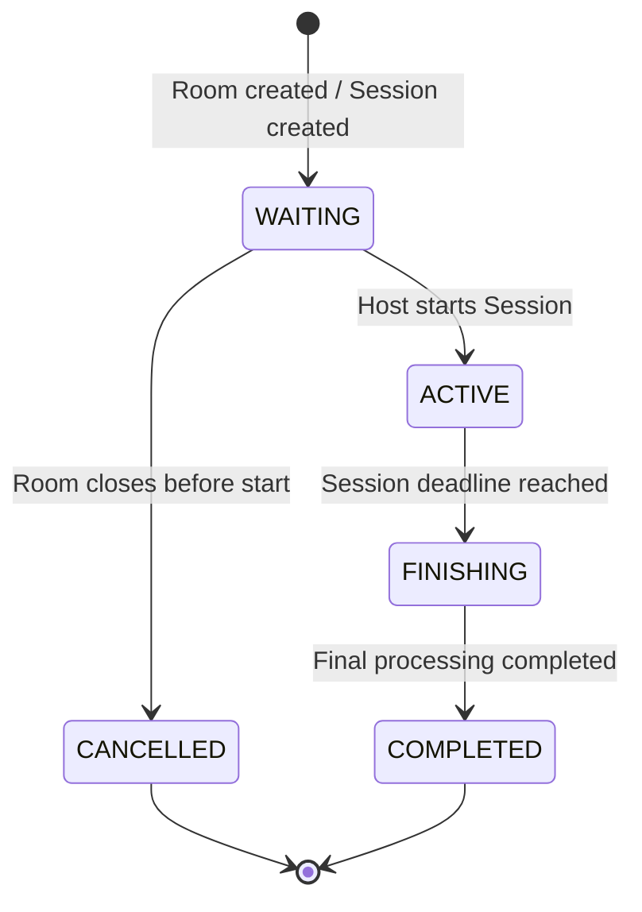

# Session State Machine

**Project:** Poker Game  
**Version:** 1.0  
**Status:** Phase 1 design  
**Suggested path:** `docs/design/state-machines/Session_State_Machine_v1.0.md`

## 1. Purpose and Scope

A Session represents one scheduled period of poker gameplay within a Room. Each Room has at most one Session. A Session tracks its participants, duration, Hands, chip transactions, and final results. Room membership and host permissions belong to the Room State Machine; betting and individual Hand progression belong to the Hand State Machine.

The backend is authoritative for all state transitions, timers, chip balances, and settlement.

## 2. States

| State | Definition |
|---|---|
| `WAITING` | Session record exists but gameplay has not started. No Session timer is running. |
| `ACTIVE` | Host has started the Session; timer is running and new Hands may begin while eligible. |
| `FINISHING` | Deadline has been reached. No new Hands may start; an existing Hand and final processing must finish. |
| `COMPLETED` | All Hands and pending operations have been resolved and final results recorded. Terminal. |
| `CANCELLED` | Session was never started and its Room closed. Terminal; excluded from completed-session statistics. |

`FINISHING` is a logical state. Whether it is persisted in `SESSION.status` is an implementation decision to settle before the initial Flyway migration.

## 3. State Transition Diagram

## 4. State Transitions

### ST-01: Create Session — Initial → WAITING

- Create the Session automatically when the Room is created.
- Associate the Session with the Room; do not create a second Session for that Room.
- The Session start timestamp is null and the timer has not begun.
- Players may join the Room, perform their first Buy-in, and take seats during this phase.
- A Buy-in creates or initializes the corresponding `SESSION_PARTICIPANT` and records a `CHIP_TRANSACTION`.

### ST-02: Start Session — WAITING → ACTIVE

**Guards:**
- The Room is `WAITING` and has not expired or closed.
- The requester is the current Room Host.
- At least two eligible players are seated.
- Duration is one of 30, 60, 90, or 120 minutes.

**Effects:**
- Persist the actual `start_at` and configured duration.
- Set the deadline to `start_at + duration`.
- Change Session to `ACTIVE` and Room to `ACTIVE` as one consistent operation.
- Initialize the first Hand and broadcast the new state.

### ST-03: Cancel Before Start — WAITING → CANCELLED

**Triggers:** Room waiting timeout (15 minutes after Room creation), or host closes the waiting Room.

**Effects:**
- Cancel the unstarted Session and close the Room.
- Do not start Hands or count the Session as completed.
- Preserve necessary participation and chip transaction history.
- Because no gameplay occurred, unused Buy-in chips are not treated as gaming losses. The exact cancellation accounting/reporting treatment must be implemented consistently.

### ST-04: Deadline Reached — ACTIVE → FINISHING

- The server determines expiration using the Session deadline, not a client countdown.
- Do not start another Hand at or after the deadline.
- If a Hand is in progress, allow it to reach normal settlement.
- If no Hand is in progress, proceed to final processing immediately.
- Reject new joins to the Session, initial Buy-ins, and new Top-up requests.
- Top-up requests accepted before expiration remain eligible for final validation and processing.

### ST-05: Complete — FINISHING → COMPLETED

**Guards:**
- No Hand remains unsettled.
- Every pending Top-up request has been applied or cancelled.
- All participant balances, transactions, and final results have been persisted.

**Effects:**
- Set the Session's final timestamp and `COMPLETED` status.
- Close the associated Room.
- Notify participants and expose the completed results.
- Perform finalization idempotently so retries cannot double-apply chips or transactions.

## 5. Duration and Hand Scheduling

- Supported Session durations: **30, 60, 90, or 120 minutes**.
- Time begins only on `WAITING → ACTIVE`, not when the Room or Session record is created.
- Time continues when all players leave, stand up, or disconnect.
- If fewer than two eligible players are seated, do not start a new Hand; keep the Session `ACTIVE` and its clock running.
- If sufficient players become eligible again before the deadline, gameplay may resume.
- A Hand already started before the deadline may finish after it.
- The decision to start a new Hand must recheck the deadline atomically with scheduling the Hand.

## 6. Participant Lifecycle

### SP-01: First Participation and Seating

- Users first join the Room; joining the Room does not itself allocate a poker seat.
- A first Buy-in of **100–400 chips** is required before the player takes a seat.
- The maximum is accessed through Room configuration (`getMaxBuyIn()`), which returns 400 in Phase 1.
- No more than nine players may be seated, and Room membership may not exceed 20 including spectators.
- During `ACTIVE`, a new player can join and sit, but cannot enter a Hand already in progress.
- On first entry, the player must post the mandatory big blind on their next eligible Hand; a partial all-in blind is allowed if the remaining Stack is insufficient.

### SP-02: Standing Up and Leaving

- Players may request to stand up or leave during an `ACTIVE` Session.
- A player involved in a Hand follows the Hand State Machine's deferred-exit rule: fold at their next action if required, then stand after the Hand.
- The participant record, Stack, and chip transaction history remain associated with the Session.
- The Session timer does not pause.

### SP-03: Rejoining

- Voluntarily departing players may rejoin while the Room remains open, subject to Room access and capacity rules.
- Rejoining the same Session reuses the existing participant record and Stack; it must not trigger a second initial Buy-in.
- Players kicked from the Room may not rejoin that Room.

### SP-04: Disconnects and Action Timeouts

- A disconnected player receives the agreed **60-second reconnect grace period**; reconnection does not create a new Session participant.
- The Session timer continues during disconnection.
- Individual actions have a **30-second deadline**; two consecutive action timeouts cause automatic standing under the Hand rules.
- The precise interaction among action timeout, reconnect grace, and deferred standing is defined by the Hand State Machine.

## 7. Buy-in and Top-up

### SC-01: Initial Buy-in

- First Buy-in is available in `WAITING` and `ACTIVE` for a user who has not already initialized participation in the Session.
- Minimum: 100 chips. Default maximum: 400 chips.
- Persist the successful Buy-in as a `CHIP_TRANSACTION` and initialize the participant's Stack.
- Rejoining does not reset the Stack or permit a second initial Buy-in.

### SC-02: Top-up During an Active Hand

- Only a seated Session participant may request Top-up.
- A player may have at most one pending Top-up request.
- A request accepted while a Hand is in progress remains pending; it does not change the current Hand's available chips, bets, or all-in calculation.
- After Hand settlement and before another Hand begins, compute the allowed amount using the **post-Hand Stack**:

  `available_top_up = max(0, getMaxBuyIn() - final_stack)`

- If `requested_amount > available_top_up`, **cancel the entire request** and notify the player to enter a new amount; never partially apply it.
- Otherwise apply the full positive requested amount, update `SESSION_PARTICIPANT.stack_balance`, and record one successful `TOPUP` transaction.
- Chips won through gameplay may exceed the maximum; the limit applies to additional chips purchased, not winnings.

### SC-03: Top-up Between Hands

- If the Session is `ACTIVE` and no Hand is in progress, validate and apply an eligible Top-up immediately, before the next Hand begins.
- The same full-amount-or-cancel rule applies.
- Frontend input limits are advisory; backend validation is mandatory.

### SC-04: Top-up at Session Expiration

- Do not accept new requests once the deadline has passed.
- Requests accepted before expiration are retained.
- Settle the final Hand first; then validate each pending request against the final post-Hand Stack.
- Apply valid requests in full and cancel invalid requests in full before Session completion, even though no subsequent Hand will be played.
- A successful final Top-up increases both the final Stack and the total amount bought in, so it does not by itself create poker profit.

## 8. Final Settlement and Statistics

For each Session participant, calculate:

- **Final Stack:** the participant's Stack after final Hand settlement and all valid pending Top-ups.
- **Total Buy-in:** sum of successful initial Buy-ins and Top-ups for the Session.
- **Net Result:** `final_stack - total_buy_in`.

Only `COMPLETED` Sessions count toward completed-session statistics. A `CANCELLED` Session is excluded.

The settlement must be atomic or safely recoverable and idempotent. A retry must not create duplicate Top-up transactions or count results twice.

## 9. Operation Permissions

| Operation | WAITING | ACTIVE | FINISHING | COMPLETED / CANCELLED |
|---|:---:|:---:|:---:|:---:|
| Start Session (host) | Yes | No | No | No |
| First Buy-in | Yes | Yes | No | No |
| Sit down | Yes | Yes | No | No |
| Request stand-up | Yes | Yes | Hand-dependent | No |
| Request Top-up | No | Yes | No new requests | No |
| Apply already-pending Top-up | N/A | Yes | Yes | No |
| Start new Hand | No | Yes, if eligible | No | No |
| Complete ongoing Hand | No | Yes | Yes | No |
| Final settlement | No | No | Yes | No |

Room join/leave/kick permissions are specified in the Room State Machine. Hand-specific actions are specified in the Hand State Machine.

## 10. Invariants

1. A Room has at most one Session.
2. A Session begins in `WAITING` and starts at most once.
3. Only the host may start a Session, and at least two players must be seated.
4. The timer starts at `ACTIVE` and never pauses for an empty table or disconnections.
5. No Hand starts at or after the Session deadline.
6. A Session cannot be `COMPLETED` while a Hand remains unsettled.
7. All accepted pending Top-up requests are resolved before completion.
8. A pending Top-up never changes chips available in the current Hand.
9. Returning participants retain their Stack and transaction history.
10. `COMPLETED` and `CANCELLED` are terminal states.
11. Completion and chip transaction application must be idempotent.
12. The backend, not the client, determines state, timeouts, and final balances.

## 11. Implementation Notes / Cross-Document Dependencies

- **Persistence:** The Phase 1 relational design contains `SESSION`, `SESSION_PARTICIPANT`, `HAND`, and `CHIP_TRANSACTION`. Before writing Flyway V1, verify that chosen persisted status values, waiting-room cancellation handling, and recovery of pending Top-up requests are supported. Avoid changing the frozen schema without a separate review.
- **Current host:** Host transfer and kick eligibility belong to the Room design, not this state machine.
- **Hand timing:** Timeout-versus-action races must be serialized within each table's command processor.
- **No eligible players:** The Session stays `ACTIVE` until its deadline; the Hand scheduler waits for at least two eligible players.
- **Pending requests:** If kept only in memory, a crash can lose them. A durable strategy or explicitly documented recovery policy is needed before production deployment.
- **Session cancellation:** Accounting for pre-start Buy-ins in a cancelled Session needs a consistent rule in the implementation and reporting layer; it does not represent gameplay loss.
